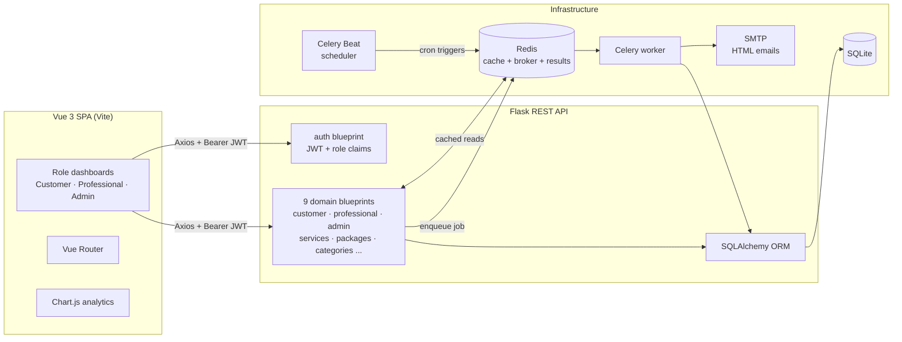
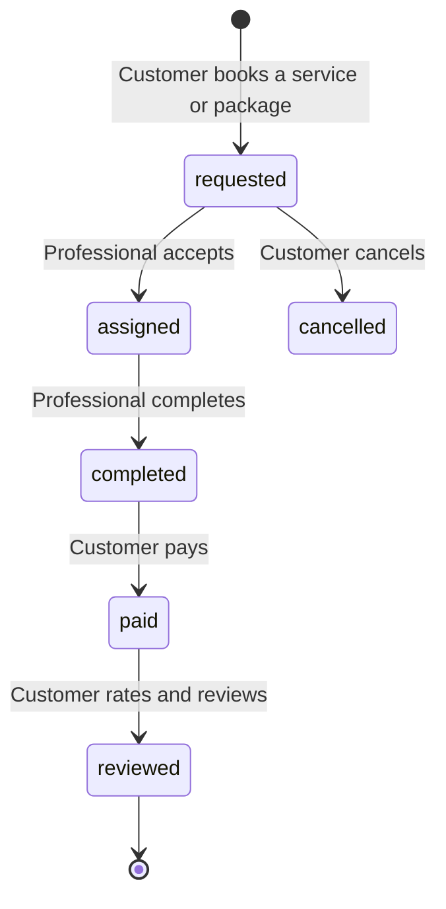
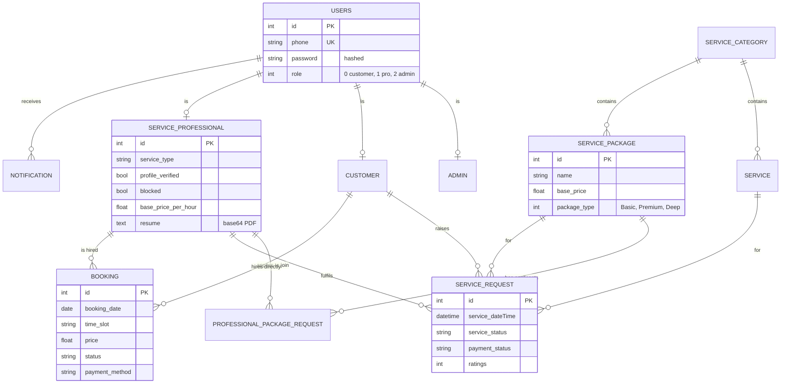

<div align="center">

# 🏠 GetWorkDone

### A three-sided home services marketplace: customers, verified professionals and an admin, on one platform.

<p>
  
  
  
  
  
  
  
</p>

<p>
  
  
</p>

**[▶ Watch the demo](https://drive.google.com/drive/folders/1ZHTMVXGkUoSboL055ywSjFw0BzRdB151?usp=drive_link)** &nbsp;·&nbsp; **[📄 Project report](Mad_2_project.pdf)** &nbsp;·&nbsp; **[⚡ Run it locally](#-run-it-locally)**

</div>

---

## The problem

Booking a plumber, a cleaner or an AC technician still mostly runs on phone calls and word of mouth. Customers can't compare prices or see reviews, professionals have no steady pipeline of work, and nobody checks who is actually walking into your home.

**GetWorkDone** tackles this with a marketplace built around three roles and a complete request lifecycle:

- **Customers** browse services by category, compare fixed-price packages, or hire a specific professional directly.
- **Professionals** sign up with their resume, get verified by an admin, then accept jobs and build a rating history.
- **Admins** run the platform: verify professionals, curate the catalogue, moderate users and track the business through live analytics.

Underneath is a Flask REST API with JWT authentication and role claims, a Redis cache, and Celery workers that handle report exports and scheduled email jobs outside the request path.

> Built as my capstone for **Modern Application Development II** in the IIT Madras BS degree, where it was awarded an **S grade**, the highest possible.

---

## ✨ At a glance

| | |
|---|---|
| **80+** REST endpoints across 10 Flask blueprints | **10** relational models with cascading integrity rules |
| **3** user roles with JWT auth and role-based dashboards | **3** background jobs: async CSV export, daily reminders, monthly reports |
| **40+** Vue 3 components | **~9,000** lines of application code (Python + Vue) |

---

## 🧩 Features by role

<table>
<tr>
<th width="33%">👤 Customer</th>
<th width="33%">🛠️ Service Professional</th>
<th width="33%">🛡️ Admin</th>
</tr>
<tr valign="top">
<td>

- Sign up and manage a profile
- Browse services by category
- Search and filter by name, category and price
- Book a **Basic / Premium / Deep** service package
- **Hire a professional directly** for a date and time slot
- Edit, cancel or close requests
- Checkout flow (simulated payment)
- Rate and review after completion

</td>
<td>

- Sign up with a **resume upload** (PDF)
- Locked out until **admin verification**
- Apply to join admin-defined service packages
- Accept or reject service requests, package jobs and direct bookings
- Mark jobs complete
- Track all accepted work from one dashboard
- Receive **daily pending-job reminders** and a **monthly activity report** by email

</td>
<td>

- Review resumes and **approve or reject** professionals
- **Block, unblock or delete** customers and professionals
- Full CRUD on **categories, services and packages**
- Approve professionals into packages
- View every request and booking on the platform
- **Analytics dashboard** (Chart.js): bookings per category, request status, top professionals, top customers, recent bookings
- **One-click CSV export** of all service data, generated asynchronously

</td>
</tr>
</table>

---

## 🏗️ Architecture



### Request lifecycle



---

## 🔍 Engineering highlights

### 1. Stateless auth with role claims
Login issues a JWT with the user's role embedded as a custom claim (`additional_claims={"role": ...}`). Protected endpoints use `@jwt_required()` and read the claim on the server, so a customer token is rejected by admin-only handlers even if the UI is bypassed. Login also enforces business rules: unverified professionals and blocked users never receive a token.

### 2. Async jobs that don't block the API
Exporting every service request to CSV can be slow, so the API never does it inline:

```
GET /api/export_csv            → enqueues a Celery task, returns { id }
GET /api/csv_report/<id>       → polls AsyncResult: "pending" | "ready" + filename
GET /api/download_csv/<file>   → serves the finished file
```

The admin panel polls until the job is ready, then downloads the file. It's the same submit, poll, fetch pattern used for long-running inference and batch jobs in production systems.

### 3. Scheduled email jobs with Celery Beat
Two cron jobs run independently of user traffic:
- **Daily reminder** to each professional summarising the pending requests waiting on the platform.
- **Monthly activity report** per professional with completed vs. pending jobs.

Both render **Jinja2 HTML email templates** inside a Flask app context (a custom `FlaskTask` base class wraps every task in `app.app_context()`) and send through Flask-Mail.

### 4. Read-through caching with explicit invalidation
The public service catalogue is the hottest read path. It is cached in Redis via Flask-Caching, and writes to the catalogue call `cache.delete(...)` on the affected key, so customers don't see a stale catalogue after an admin edit.

### 5. A relational model that reflects the business
Ten SQLAlchemy models with a shared `Users` base and one-to-one role profiles (`Admin`, `Customer`, `ServiceProfessional`). The two booking paths, marketplace **service requests** and **direct bookings**, are modelled separately because they follow different pricing and assignment rules. `ON DELETE CASCADE` and `passive_deletes` keep data consistent when an admin removes a user.

<details>
<summary><b>View the entity-relationship diagram</b></summary>



</details>

### 6. Analytics built on aggregate queries
The admin dashboard is fed by dedicated endpoints (`/admin/stats`, `/admin/bookings-per-category`, `/admin/service-request-status`, `/admin/top-professionals`, `/admin/top-customers`) that aggregate in the database and return chart-ready JSON, rendered with reusable `BarChart` and `PieChart` components.

---

## 🛠️ Tech stack

| Layer | Technology |
|---|---|
| **Frontend** | Vue 3, Vue Router, Pinia, Axios, Chart.js / vue-chartjs, Bootstrap 5, Vite |
| **Backend** | Python, Flask 3, Flask Blueprints, SQLAlchemy 2, Flask-JWT-Extended, Flask-CORS, Werkzeug password hashing |
| **Async and scheduling** | Celery 5 (worker + Beat), Redis as broker and result backend |
| **Caching** | Redis via Flask-Caching |
| **Email** | Flask-Mail over SMTP with Jinja2 HTML templates |
| **Database** | SQLite through SQLAlchemy (swappable for PostgreSQL) |

---

## 📡 API overview

<details>
<summary><b>Selected endpoints (80+ in total)</b></summary>

| Method | Endpoint | Purpose | Used by |
|---|---|---|---|
| `POST` | `/auth/signup/customer` | Register a customer | Public |
| `POST` | `/auth/signup/professional` | Register a professional with resume | Public |
| `POST` | `/auth/login` | Issue a JWT with role claim | Public |
| `GET` | `/api/services` | Service catalogue (Redis-cached) | Public |
| `GET` | `/api/packages` | Service packages | Public |
| `GET` | `/api/all_professionals` | Verified professionals | Public |
| `POST` | `/api/customers/service-requests/create` | Book a service or package | Customer |
| `POST` | `/api/customers/bookings/create` | Hire a professional directly | Customer |
| `POST` | `/api/customer/service-review/<id>` | Rate and review a job | Customer |
| `POST` | `/api/professionals/packages/apply` | Apply to join a package | Professional |
| `POST` | `/api/professional/accept-service/<id>` | Accept a service request | Professional |
| `GET` | `/api/admin/professionals/pending-requests` | Professionals awaiting verification | Admin |
| `PUT` | `/api/admin/professionals/approve/<id>` | Verify a professional | Admin |
| `PUT` | `/api/admin/users/block/<id>` | Block or unblock a user | Admin |
| `POST` | `/api/service-categories` | Create a category | Admin |
| `GET` | `/api/admin/stats` | Platform KPIs for the dashboard | Admin |
| `GET` | `/api/export_csv` | Start an async CSV export | Admin |
| `GET` | `/api/csv_report/<task_id>` | Poll export status | Admin |

</details>

---

## 📁 Project structure

```
.
├── client_side/                 # Vue 3 SPA
│   ├── src/
│   │   ├── views/               # Landing, Login, Signup, Services, 3 role dashboards
│   │   ├── components/
│   │   │   ├── admin/           # Analytics, user and catalogue management, all requests/bookings
│   │   │   ├── customer/        # Requests, bookings, payment modal, profile
│   │   │   ├── professional/    # Job queue, accepted services, profile
│   │   │   └── charts/          # Reusable Bar / Pie chart components
│   │   └── router/
│   └── package.json
├── server_side/                 # Flask API
│   ├── main.py                  # App entry point + Celery Beat schedule
│   ├── celery_config.py         # Broker / result backend config
│   └── backend/
│       ├── __init__.py          # App factory, extensions, admin seeding
│       ├── models.py            # 10 SQLAlchemy models
│       ├── api.py               # Blueprint registration
│       ├── auth.py              # Signup, login, JWT
│       ├── admin.py · customer.py · professional.py · ...
│       ├── tasks.py             # Celery tasks (CSV export, email jobs)
│       └── templates/           # HTML email templates
├── requirements.txt
├── .env.example
└── Mad_2_project.pdf            # Project report
```

---

## ⚡ Run it locally

**Prerequisites:** Python 3.11+, Node.js 18+, and Redis running on `localhost:6379`.

**1. Backend API**

```bash
python -m venv .venv
source .venv/bin/activate            # Windows: .venv\Scripts\activate
pip install -r requirements.txt

cp .env.example .env                 # fill in your values, then load them
export $(grep -v '^#' .env | xargs)  # Windows: set each variable manually

cd server_side
python main.py                       # http://127.0.0.1:5000
```

**2. Celery worker and scheduler** (two more terminals, from `server_side/`)

```bash
celery -A main.celery worker --loglevel=info
celery -A main.celery beat   --loglevel=info
```

**3. Frontend**

```bash
cd client_side
npm install
npm run dev                          # http://localhost:5173
```

On first run the app creates the database and seeds an admin account (phone `9876543210`, password `12345`) for local testing.

---

## 🧭 What I would build next

Shipping this taught me as much about the gaps as about the features. To take it to production, my next steps would be:

- **PostgreSQL + Alembic migrations** in place of SQLite and `create_all()`
- **Docker Compose** to start the API, worker, scheduler, Redis and database with one command
- **pytest suite and CI** covering auth rules and the request state machine
- **Real payments** (Razorpay / Stripe) with webhook-driven status updates
- **Object storage** for resumes and images instead of base64 in the database
- **Smarter matching:** rank professionals for each request by distance, rating, price and availability, and use an LLM to summarise reviews and pre-screen resumes during verification

---

## 👋 About me

I'm **Rafraf Reza**, a student in the IIT Madras BS programme. I build end-to-end products, from data models and APIs to background workers and polished frontends, and my focus today is **AI and GenAI engineering**: LLM agents, retrieval, and the infrastructure that puts them in production.

I'm open to **AI Engineer, GenAI Engineer, ML and Software Engineer** roles, remote with startups worldwide or hybrid / on-site in India.

<p>
  <a href="https://github.com/rafrafreza"></a>
</p>

If this project caught your eye, have a look at my other work or reach out. I'd be glad to talk.
